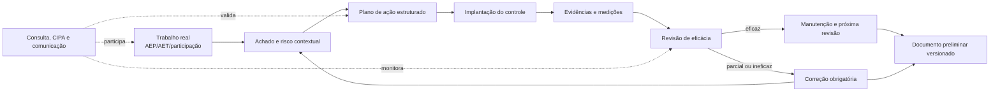

# Plano ToT de ondas para o MVP de execução NR-1

- Data: 07/08/2026
- Classificação: `MASTER`
- Estado: plano estratégico e técnico; não constitui implementação, aprovação de gate ou autorização para dados reais.

## 1. Decisão executiva

O primeiro produto viável não deve tentar ser um “PGR completo automático”. Deve ser um **MVP Assistido de Execução e Evidências NR-1**, inicialmente sintético, capaz de fechar com rastreabilidade o ciclo:

> compreender o trabalho real → registrar o risco contextual → planejar a ação → implantar o controle → comprovar a execução → monitorar a eficácia → corrigir ou manter → reavaliar → compor evidência documental preliminar.

A escolha resultante do Tree of Thoughts é:

- entregar primeiro a vertical de execução, evidência e eficácia, o ramo C;
- usar um núcleo reutilizável de workflow, evidência e decisão, o ramo F, como direção arquitetural;
- não colocar IA, scoring automático, anexos remotos ou promessa de conformidade no caminho crítico do MVP;
- manter revisão humana competente e participação de trabalhadores/CIPA como requisitos do fluxo, não como textos decorativos;
- concluir primeiro um **MVP Técnico Sintético**; qualquer **MVP de Serviço com dados reais** permanece condicionado a G3 e às aprovações formais.

O diferencial “premium” será medido por enforcement no servidor, privacidade, rastreabilidade, acessibilidade, qualidade das evidências e honestidade regulatória — não pela quantidade de telas ou automações.

## 2. Fonte e limites da análise

Documento analisado:

- `C:\Users\FIB2030\Downloads\Estudos felicidade\Guia Oficial MTE 2026 Comentado.pdf`;
- título nos metadados: `Guia Oficial Comentado Março 2026`;
- 140 páginas;
- o próprio material informa que tem natureza orientativa e não substitui o texto legal da NR-1. Em caso de divergência, prevalecem a norma vigente, os atos oficiais e a avaliação dos profissionais competentes.

Recortes usados para este plano:

| Tema | Páginas do guia | Implicação para o produto |
|---|---:|---|
| PDCA, GRO e documentos mínimos do PGR | 13–15 | O app precisa fechar ciclos, não apenas cadastrar riscos. |
| Participação, consulta e comunicação | 22–24 | Trabalhadores e CIPA precisam participar e receber devolutiva consolidada. |
| Planejamento, responsabilidades e critérios | 30–36 | Escopo, papéis, recursos e critérios devem ser explícitos e versionados. |
| Implantação, manutenção e monitoramento dos controles | 74–81 | Ação concluída exige comprovação, monitoramento e julgamento de eficácia. |
| Critérios, inventário e plano de ação | 87–97 | Documentos precisam de autoria, data, versão, ligação entre riscos e ações e histórico. |
| Riscos psicossociais, NR-17, AEP/AET e trabalho real | 109–121 | Questionário isolado não equivale a gerenciamento; a fonte deve ser a organização do trabalho. |

Esta leitura gera requisitos de produto, mas não é parecer jurídico, laudo, validação metodológica ou garantia de conformidade.

Base interna confrontada:

- `docs/PROJECT_CONSTITUTION.md`, `docs/G0_EXECUTION_RECORD.md` e `docs/IMPLEMENTATION_STATUS.md`;
- `docs/AEP_WORK_CONTEXT_G2.md`, `docs/AET_FLOW_G2.md` e `docs/CRITERIA_ENGINE_G2.md`;
- `docs/ACTION_EVIDENCE_REVIEW_G1.md` e `docs/CONTROL_EVIDENCE_REVIEW_G1.md`;
- `docs/DATA_GOVERNANCE_G1.md`, `docs/PRIVACY_VAULT_G1.md` e `docs/ORIENTATIVE_DOCUMENT_TEMPLATES_G1.md`.

## 3. Tree of Thoughts aplicado

Lentes usadas em todos os ramos: SST/Ergonomia e regulação; trabalhador, CIPA, UX e acessibilidade; privacidade/LGPD e segurança; metodologia e auditabilidade; produto e operação; arquitetura e manutenção.

### 3.1 Critérios

Cada ramo recebeu nota de 0 a 10, sendo 10 sempre o resultado mais favorável. Os pesos priorizam valor, aderência ao ciclo de gestão e privacidade.

| Critério | Peso |
|---|---:|
| Valor para o usuário | 15% |
| Aderência ao ciclo NR-1/GRO | 15% |
| Privacidade e segurança | 15% |
| Tempo até evidência utilizável | 10% |
| Reuso arquitetural | 10% |
| Adoção operacional | 10% |
| Simplicidade e reversibilidade | 10% |
| Escalabilidade | 5% |
| Baixa dependência externa | 10% |

### 3.2 Ramos avaliados

| Ramo | Ideia | Nota ponderada | Leitura |
|---|---|---:|---|
| A | CRUD de ações e controles, com validações na interface | 65,0 | Rápido, mas cria aparência de controle sem prova auditável. |
| B | Implementar todo o PGR e todos os perigos antes do MVP | 64,0 | Forte no destino, lento e difícil de validar como primeira entrega. |
| C | Vertical psicossocial de ação → evidência → eficácia → correção | **83,5** | Melhor equilíbrio entre valor, rigor, tempo e risco. |
| D | Serviço assistido e documentos manuais sem núcleo transacional | 70,5 | Útil para aprender, mas pouco escalável e com rastreabilidade frágil. |
| E | Integrar ferramenta externa de GRC/projetos | 58,0 | Aumenta dependência, DPA, integração e risco de inadequação ao domínio. |
| F | Criar primeiro um motor genérico de workflow e evidências | 74,5 | Excelente direção, mas abstrato demais como primeira entrega isolada. |

### 3.3 Escolha

**Escolha: C como fatia de produto, sustentada por F como arquitetura.**

Trade-offs aceitos:

- o MVP cobrirá profundamente a execução dos controles psicossociais, não superficialmente todo o GRO;
- documentos permanecerão preliminares até revisão e assinatura competentes;
- o primeiro marco será demonstrável com dados sintéticos, mas não poderá ser vendido como piloto real;
- anexos binários, notificações externas e integrações serão condicionais, para não abrir cedo superfícies de malware, retenção, DPA e secrets;
- o hash comprovará integridade e versão, não a veracidade material de uma evidência.

## 4. Estado real do produto

| Capacidade | Estado confirmado | Lacuna para o MVP |
|---|---|---|
| Privacy Vault, RLS, isolamento entre tenants e `k ≥ 5` | Implementados e testados localmente | Aprovações formais e validação em ambiente autorizado. |
| AEP e observação do trabalho real | Implementadas como protocolo draft, com estados, evidências, hash e revisão | Validação por SST/Ergonomia, usabilidade e autorização de uso. |
| AET | Fluxo draft implementado, incluindo recomendação que origina ação | Validação profissional e regulatória; anexos seguros. |
| Criteria Engine | Mecanismo versionado e fail-closed implementado | Fórmula, bandas, fontes e aprovação metodológica; o seed continua bloqueado. |
| Planejamento de ações | CRUD, responsável, prazo e avaliador textual na interface | Campos estruturados, máquina de estados e fechamento impostos no servidor. |
| Controles | Catálogo, declaração organizacional, notas e divergência consultiva | Separar controle declarado de controle implantado; manutenção, evidência e revisão server-side. |
| Evidência de ação e controle | Inferida por padrões de texto em descrição/notas | Entidades estruturadas, histórico append-only, hash, autoria e vínculo com o risco. |
| Eficácia e correção | Guardrails locais e rascunhos | Medição, revisão, resultado e obrigação de correção impostos no servidor. |
| Participação e comunicação | Exigidas nos fluxos AEP/AET | Registro transversal de consulta, decisão, devolutiva e participação na monitoração. |
| Documentos | Versão, hash e revisão para documentos preliminares; modelos orientativos locais | Linhagem completa critérios → inventário → ação → evidência → revisão. |
| Ciclo de vida dos dados | Mecanismo versionado e fail-closed implementado | Prazos, bases, responsáveis e descarte ainda não aprovados. |
| Instrumento e scoring | Registry e mecanismos existem em estado draft/bloqueado | Fontes, licença, propriedades psicométricas e aprovação técnica. |

Consequência: o repositório já tem blocos valiosos, mas a camada central de **execução comprovável da ação** ainda é parcial. Descrição com palavras-chave não pode continuar sendo tratada como evidência de implantação ou eficácia.

## 5. Definição do MVP

### 5.1 Nome de trabalho

**Playbook NR-1 — Execução & Evidências Assistidas**

### 5.2 Usuário e trabalho principal

Usuário primário: responsável de SST/Ergonomia ou gestor autorizado que precisa converter um achado sobre a organização do trabalho em um plano executável, acompanhar sua implantação e demonstrar por que a medida foi mantida, ajustada ou substituída.

Participantes indispensáveis:

- responsável pela execução;
- revisor técnico competente;
- trabalhador(es) e/ou representação da CIPA, conforme o contexto;
- gestor organizacional com autoridade para recursos e mudanças;
- privacidade/jurídico quando houver dados reais ou documentos sujeitos a retenção.

### 5.3 Escopo obrigatório

O MVP precisa permitir:

1. criar ação ligada a achado, risco ou requisito explícito; em risco psicossocial, a origem deve incluir AEP e trabalho real, usando AET somente quando tecnicamente indicada;
2. classificar a medida como introdução, melhoria ou manutenção;
3. registrar prioridade, justificativa, população exposta sob controle de acesso, responsável, prazo e recursos;
4. definir método de monitoramento, indicador, baseline quando aplicável, meta e critério de eficácia;
5. ligar a ação a uma implantação concreta de controle, sem confundir catálogo com implantação;
6. registrar evidências estruturadas, autoria, data, versão, origem e hash;
7. impedir encerramento direto sem execução, evidência e revisão;
8. concluir a revisão como eficaz, parcialmente eficaz ou ineficaz;
9. exigir correção e reavaliação quando a medida for insuficiente;
10. registrar participação/consulta e comunicação consolidada sem ligar pessoas às respostas do questionário;
11. gerar pacote preliminar versionado de critérios, inventário e plano de ação;
12. manter linguagem explícita de apoio à gestão, sem diagnóstico, laudo automático ou garantia de conformidade.

Para risco psicossocial, toda ação deve se ligar a uma fonte ou condição da organização do trabalho. Ações individuais de bem-estar podem ser complementares, mas não podem ser o único controle de um perigo organizacional.

### 5.4 Fora do MVP

- PGR completo para todas as classes de perigo;
- gestão de emergências, contratadas, PCMSO ou prontuário médico;
- diagnóstico individual ou correlação convite ↔ resposta;
- redução automática do risco por simples declaração de controle;
- decisão automática sobre necessidade de AET;
- certificação ou promessa de conformidade automática;
- IA generativa decidindo prioridade, eficácia, fechamento ou assinatura;
- upload de binários antes de política de storage, malware scanning, retenção e acesso;
- integrações remotas antes de fornecedor, DPA, subprocessadores e incident response aprovados.

## 6. Arquitetura-alvo mínima

Fronteiras obrigatórias:

- respostas individuais permanecem service-only e nunca são vinculadas à identidade, ao convite ou à trilha de ação;
- dashboards coletivos respeitam `k ≥ 5`; documentos com contagens restritas usam autorização própria;
- comandos de transição passam por RPC/serviço server-side; componentes React não são autoridade de fechamento;
- eventos, revisões e hashes são append-only;
- operações sensíveis usam controle de concorrência/idempotência para evitar dupla aprovação ou sobrescrita;
- recomendação de catálogo é apenas sugestão; implantação e eficácia exigem evidência própria;
- score residual não muda automaticamente a partir de um status ou nota textual.

Modelo conceitual a validar em ADR antes de migration:

| Bloco | Intenção |
|---|---|
| `action_items` evoluído | Origem, tipo de intervenção, prioridade, responsável, prazo, monitoramento e estado. |
| `action_events` | Ledger imutável de mudanças, decisões e transições. |
| `control_implementations` | Instância real do controle por escopo, distinta do catálogo e da mera declaração. |
| `evidence_records` | Evidência estruturada, referência, autoria, data, versão e hash. |
| `action_measurements` | Baseline, meta, medição, método, data e fonte. |
| `effectiveness_reviews` | Julgamento técnico, evidências consideradas, resultado e próxima decisão. |
| `participation_records` | Consulta e participação por papel/grupo, sem identidade de respondente. |
| `communication_records` | Devolutiva de riscos consolidados, medidas e mudanças aprovadas. |

Os nomes finais e a decisão entre evoluir tabelas existentes ou criar novas tabelas devem ser fechados na Onda 0. Nenhuma migration está autorizada por este documento.

## 7. Ondas de desenvolvimento

As durações são hipóteses para uma equipe dedicada com duas pessoas de engenharia, produto ativo e especialistas disponíveis em checkpoints. O avanço depende de evidência de aceite, não apenas de calendário. Estimativa inicial: **10 a 14 semanas até o MVP Técnico Sintético**.

### Onda 0 — Contrato de produto, fonte e ameaça

Duração estimada: 1 semana.

Objetivo: congelar a fatia vertical e retirar ambiguidade antes de schema.

Entregas:

- matriz requisito → página do guia → regra de domínio → evidência → responsável pelo aceite;
- ADR do modelo de ação, controle, evidência, eficácia e correção;
- threat model de respostas, contagens, evidências, documentos e participação;
- mapa de compatibilidade dos dados atuais codificados em `description` e `notes`;
- protótipo navegável dos estados e microcopy sem overclaim;
- decisão explícita sobre evidência apenas estruturada no MVP e sobre o gate futuro de binários.

Gate de saída:

- produto, SST/Ergonomia, privacidade e engenharia aprovam o contrato;
- nenhum requisito obrigatório depende de IA;
- migração reversível e estratégia de rollback revisadas;
- segue proibido criar ou executar migration sem autorização específica.

### Onda 1 — Núcleo server-side do plano de ação

Duração estimada: 2 semanas.

Objetivo: substituir “tarefa com texto” por plano de ação governado.

Entregas:

- campos estruturados de origem, introduzir/melhorar/manter, prioridade, população exposta como fator de priorização, responsável, prazo, método de monitoramento e efeito esperado;
- máquina de estados monotônica, por exemplo `draft → planned → approved → in_progress → under_review → verified|corrective_required`;
- transições por RPC, RLS, controle de versão e ledger append-only;
- bloqueio server-side de atalhos para `done`;
- adaptação compatível da tela de Ações, com estados vazio, rascunho, bloqueado, atrasado e revisão;
- política para exibir contagens: detalhes restritos no PGR e supressão/bandas em superfícies amplas.

Aceite:

- não existe fechamento por update direto;
- toda ação aprovada tem origem, dono, prazo, monitoramento e critério de eficácia;
- ação de risco alto/crítico exige revisor distinto do executor;
- testes unitários, pgTAP/RLS cross-tenant, integração e rollback aprovados com dados sintéticos.

### Onda 2 — Implantação do controle e evidência verificável

Duração estimada: 2 semanas.

Objetivo: provar o que foi implantado, quando, por quem e em qual escopo.

Entregas:

- instância de controle separada do catálogo e de `org_controls.notes`;
- vínculo entre ação, controle, área/grupo, escopo e versão;
- evidência estruturada com tipo, fonte, data, responsável, referência e hash;
- manutenção programada e registros de inspeção/verificação;
- revisão técnica da suficiência da evidência;
- migração assistida do texto legado, classificado como `legacy_unverified`, sem convertê-lo automaticamente em prova.

Aceite:

- declarar um controle nunca altera o risco nem encerra a ação;
- evidência editada produz nova versão; não sobrescreve o histórico;
- nenhuma evidência cruza tenant;
- hash e assinatura registram integridade/autoria sem alegar veracidade absoluta;
- upload binário continua bloqueado até os controles de segurança e retenção serem aceitos.

### Onda 3 — Monitoramento, eficácia e correção

Duração estimada: 2 semanas.

Objetivo: fechar o “Check/Act” do PDCA.

Entregas:

- indicadores proativos e reativos, baseline, meta, periodicidade, método e fonte;
- medições e inspeções ligadas à ação/controle;
- revisão de eficácia com resultado `effective`, `partially_effective` ou `ineffective`;
- justificativa técnica, evidências usadas, revisor e data da próxima revisão;
- workflow obrigatório de correção/reavaliação para resultado parcial ou ineficaz;
- manutenção recorrente para controles eficazes que precisam ser sustentados;
- painel operacional de vencimentos, bloqueios, revisões e correções, sem score individual.

Aceite:

- não há estado “concluído” sem revisão de eficácia;
- resultado ineficaz não pode ser encerrado sem ação corretiva vinculada;
- o sistema nunca reduz automaticamente severidade ou probabilidade;
- concorrência, reprocessamento e transições inválidas falham fechados.

### Onda 4 — Participação, CIPA e comunicação

Duração estimada: 1 a 2 semanas; pode iniciar após a Onda 1 em paralelo controlado.

Objetivo: tornar participação e devolutiva partes verificáveis da gestão.

Entregas:

- registro de consulta durante levantamento, escolha da medida e revisão de eficácia;
- canal e registro de participação de CIPA/representantes e trabalhadores;
- decisão tomada, contribuições consolidadas, resposta da organização e data;
- comunicação de riscos consolidados e medidas do plano de ação;
- experiência responsiva, acessível por teclado e compreensível em linguagem simples;
- separação entre ata nominativa autorizada e registro coletivo padrão sem identidade de respondente.

Aceite:

- nenhuma participação cria correlação com convite ou resposta;
- fluxos obrigatórios sinalizam ausência de consulta/devolutiva;
- revisão manual de acessibilidade cobre desktop e mobile;
- trabalhador vê informação consolidada compatível com seu papel, sem microdados.

### Onda 5 — Pacote preliminar PGR e linhagem documental

Duração estimada: 2 semanas.

Objetivo: compor evidência documental coerente a partir dos dados transacionais.

Entregas:

- documento de critérios com versões e decisões aplicáveis;
- segmento de inventário com processo/ambiente, atividade, perigo, fonte, circunstância, agravo possível, grupo exposto, controles e classificação aprovada;
- plano de ação com prioridade, introdução/melhoria/manutenção, responsável, prazo, método de monitoramento e medição do resultado;
- índice de evidências, participações, revisões, correções e histórico;
- autoria, data, versão, SHA-256, revisão técnica e estado preliminar explícito;
- desenho de retenção do histórico do inventário por 20 anos, ativável somente após base, política e responsáveis aprovados.

Aceite:

- cada item documental retorna à fonte transacional e à versão usada;
- documento com bloqueador não pode ser apresentado como final;
- revisão posterior cria nova versão e preserva histórico;
- disponibilização a trabalhadores, sindicato e fiscalização é atendida por visão ou exportação autorizada, conforme papel e finalidade, sem expor respostas individuais;
- retenção permanece fail-closed enquanto a política não estiver formalmente aprovada.

### Onda 6 — Prova sintética ponta a ponta

Duração estimada: 1 semana.

Objetivo: demonstrar que a fatia funciona como sistema e produzir evidência para decisão de gate.

Cenário obrigatório:

1. achado sintético aprovado sobre organização do trabalho;
2. risco contextual e prioridade justificados;
3. ação aprovada e controle implantado;
4. participação e comunicação registradas;
5. evidência e medições adicionadas;
6. primeira revisão indica eficácia parcial;
7. sistema exige correção;
8. segunda revisão confirma eficácia suficiente e programa manutenção;
9. pacote documental preliminar é gerado, versionado e revisado.

Aceite:

- E2E do caminho feliz e dos bloqueios críticos;
- testes de domínio, typecheck, lint, build e orçamento de bundle;
- pgTAP para RLS, estados, imutabilidade e cross-tenant;
- acessibilidade automatizada e revisão manual dos fluxos críticos;
- exercício de rollback/restore e verificação de hash;
- zero secrets, dados reais, respostas identificáveis ou claims de conformidade;
- aceite de G1 é decisão humana registrada; a suíte não avança o gate sozinha.

### Onda 7 condicional — MVP de Serviço controlado

Esta onda não está autorizada. Só pode iniciar após G3 e todos os pré-requisitos formais:

- instrumento, licença, scoring e critérios aprovados;
- SST/Ergonomia, metodologia, DPO, jurídico, segurança e produto com aceite registrado;
- base legal, transparência, retenção, descarte, incidentes, DPA e subprocessadores definidos;
- RLS/RPCs revalidadas em ambiente autorizado, pentest/revisão independente e recuperação exercitada;
- política de anexos, malware scanning e storage aprovada;
- protocolo de situações sensíveis e suporte operacional;
- organização parceira, CIPA/representação e escopo controlado definidos.

O serviço inicial deve ser assistido por profissional competente, limitado a uma organização parceira e apresentado como apoio ao processo de gestão, nunca como “conformidade automática”.

## 8. Critérios de sucesso do MVP Técnico Sintético

Todos são necessários:

- 100% das ações aprovadas têm origem, tipo, responsável, prazo, monitoramento e critério de eficácia;
- 0 fechamentos realizados por bypass da máquina de estados;
- 100% dos controles considerados implantados têm evidência estruturada e revisão;
- 100% dos resultados parciais/ineficazes abrem o fluxo de correção;
- 100% das ações psicossociais apontam uma fonte/condição organizacional;
- 100% das ações críticas registram consulta ou justificativa de bloqueio;
- 0 correlações entre identidade, convite e resposta;
- 0 vazamentos cross-tenant e 0 exposições de grupos abaixo de `k` em superfícies coletivas;
- pacote documental reproduzível a partir das versões e hashes registrados;
- fluxo crítico utilizável por teclado, em viewport móvel e com microcopy sem overclaim.

Indicadores operacionais para evolução:

- tempo mediano entre risco aprovado e ação aprovada;
- percentual de ações executadas no prazo;
- percentual de controles com manutenção em dia;
- tempo entre vencimento, revisão e correção;
- percentual de evidências aceitas na primeira revisão;
- cobertura de consulta por etapa e área, sem medir indivíduos;
- taxa de reabertura por eficácia insuficiente;
- tempo para produzir o pacote documental preliminar.

Os indicadores não devem ser convertidos automaticamente em diagnóstico, nexo causal, score de saúde individual ou promessa de redução de risco.

## 9. RACI mínimo

| Decisão/atividade | Responsável | Aprovador | Consultados |
|---|---|---|---|
| Escopo e prioridade do MVP | Produto | Sponsor/PO | SST, Engenharia, Privacidade |
| Protocolo de AEP/AET e critérios | SST/Ergonomia/Metodologia | Responsável técnico competente | Trabalhadores/CIPA, Produto |
| Arquitetura, schema, RLS e RPC | Engenharia | Responsável técnico de Engenharia | Segurança, Privacidade, QA |
| Base legal, retenção e transparência | DPO/Jurídico | Controlador | Segurança, SST, Produto |
| Execução da ação | Gestor designado | Dono organizacional da ação | Trabalhadores/CIPA, SST |
| Revisão de eficácia | Revisor técnico | Responsável técnico competente | Executor, trabalhadores/CIPA |
| Aceite de onda/gate | Donos formais do gate | Comitê definido no projeto | Evidências de QA e especialistas |

Separação de funções: em ações de maior risco, executor e revisor não devem ser a mesma pessoa. Aprovação técnica não substitui aprovação jurídica, de privacidade ou de gate.

## 10. Riscos prioritários e mitigação

| Risco | Consequência | Mitigação |
|---|---|---|
| Tratar o guia comentado como norma ou parecer | Overclaim e decisão incorreta | Manter rastreabilidade à NR vigente e revisão jurídica/técnica. |
| Preservar regex de texto como prova | Falso positivo de execução/eficácia | Migrar para registros estruturados e enforcement server-side. |
| Confundir catálogo com controle implantado | Redução indevida do risco | Criar instância, evidência, manutenção e revisão próprias. |
| Ação focada só no indivíduo | Não atua na fonte psicossocial | Exigir vínculo com condição da organização do trabalho. |
| Identificar trabalhador por participação ou grupo pequeno | Retaliação e violação de privacidade | Minimização, papéis coletivos, `k ≥ 5`, RLS e trilhas separadas. |
| Hash ser interpretado como prova de verdade | Confiança indevida | Comunicar que hash prova integridade/versão; revisão prova suficiência técnica. |
| Binários introduzirem malware ou retenção indefinida | Incidente de segurança | Adiar upload até scanning, storage, RBAC e política aprovados. |
| Workflow excessivamente burocrático | Baixa adoção e atalhos fora do sistema | Defaults, templates, progressive disclosure e testes com usuários. |
| Migração quebrar descrições/notas atuais | Perda de histórico | Importar como legado não verificado, preservar original e testar rollback. |
| Dependência de instrumento/scoring bloquear o núcleo | Atraso do MVP | Testar execução com achados sintéticos aprovados; manter critérios fail-closed. |
| Escopo crescer para todo o PGR | MVP nunca chega ao uso | Fixar o wedge psicossocial e registrar itens fora do escopo. |

## 11. Ordem de prioridade

### Must have

- plano de ação estruturado e server-side;
- implantação de controle distinta de declaração;
- evidência, monitoramento, eficácia e correção;
- participação/comunicação sem correlação individual;
- documentação preliminar versionada e rastreável;
- RLS, `k ≥ 5`, audit trail, acessibilidade e claims conservadores.

### Should have após o núcleo

- templates por fonte de risco organizacional;
- lembretes internos e visão de capacidade/atrasos;
- inspeções recorrentes e manutenção programada;
- comparação entre ciclos em nível coletivo seguro.

### Could have

- integração com calendário, storage ou assinatura aprovados;
- importação/exportação controlada;
- copiloto supervisionado para rascunhos, sempre com fontes e revisão.

### Won't have neste MVP

- decisão de conformidade por IA;
- diagnóstico ou tratamento individual;
- score residual automático;
- PGR completo multirriscos;
- produção com dados reais antes dos gates.

## 12. Primeiros dez dias úteis

| Dia | Resultado esperado |
|---:|---|
| 1–2 | Matriz de rastreabilidade do guia e inventário dos campos/fluxos existentes. |
| 3 | Workshop de estados e papéis com Produto, SST/Ergonomia e Privacidade. |
| 4 | ADR do modelo mínimo e decisão evoluir-versus-criar tabelas. |
| 5 | Threat model, matriz de permissões e casos de bypass. |
| 6 | Protótipo do fluxo ação → evidência → revisão → correção. |
| 7 | Plano de compatibilidade dos dados legados e rollback. |
| 8 | Contratos de teste: domínio, pgTAP, integração, E2E e acessibilidade. |
| 9 | Revisão crítica por engenharia e especialistas; correção das lacunas. |
| 10 | Go/No-Go documentado para implementar a Onda 1. |

Primeiro passo executável: **aprovar a Onda 0 e autorizar somente a produção do ADR, da matriz de rastreabilidade e do protótipo**. Schema, migration e uso com dados reais exigem decisões posteriores explícitas.

## 13. Definição de pronto do programa

O programa só alcança o MVP Técnico Sintético quando:

- a vertical completa passa com cenário sintético e casos adversos;
- controles críticos estão no servidor e falham fechados;
- a separação implementado/documentado/mockado/bloqueado está atualizada;
- especialistas registram pendências e limites sem linguagem ambígua;
- o pacote de evidências permite reproduzir cada decisão e versão;
- riscos residuais, rollback e próximos gates estão documentados;
- ninguém confunde conclusão técnica com liberação de dados reais.

O MVP de Serviço só existe quando, além disso, os gates e aceites externos necessários estiverem formalmente concluídos. Até lá, a entrega é um sistema técnico sintético demonstrável, não uma operação regulatória produtiva.
